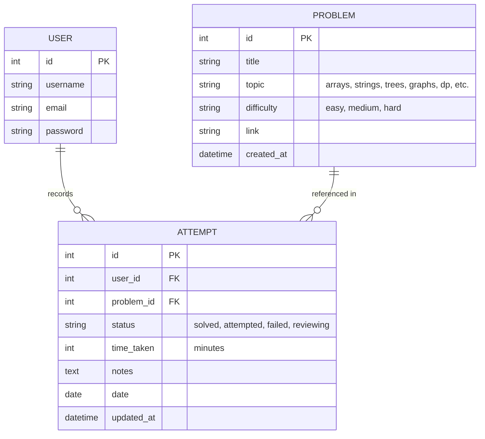

# Interview Prep Tracker API

[](https://www.python.org/)
[](https://www.djangoproject.com/)
[](https://www.django-rest-framework.org/)
[](/api/docs/)
[](/tracker/tests/)

A robust, production-ready backend REST API built with **Django** and **Django REST Framework (DRF)** to track technical interview preparation, problem attempts, time metrics, and performance analytics.

Custom-engineered with JWT authentication, row-level data isolation, database-level query optimization, and OpenAPI 3.0 interactive documentation.

---

## Key Features

- **JWT Authentication (`djangorestframework-simplejwt`)**:
  - Secure registration, login, and token refresh endpoints.
  - Stateless Bearer token verification.
- **Data Models & Constraints**:
  - `Problem`: Categorized by topic and difficulty, storing external problem URLs.
  - `Attempt`: Tracks solve status (`solved`, `attempted`, `failed`, `reviewing`), duration in minutes, personal notes, and dates.
  - Database-level `UniqueConstraint(fields=['user', 'problem'])` preventing duplicate attempt records per candidate.
- **Row-Level Security & Defense-in-Depth Permissions**:
  - `get_queryset()` strictly filters records scoped to `request.user`.
  - Object-level `IsOwner` permission prevents cross-tenant access. User A receives `404 Not Found` when trying to view, update, or delete User B's attempts.
- **Advanced Querying**:
  - Topic and difficulty filtering via `django-filter` (`?topic=arrays&difficulty=easy`).
  - Search by problem title and attempt notes (`?search=tree`).
  - Configurable page-based pagination (`?page=2&page_size=10`).
- **High-Performance Aggregated Analytics**:
  - Dedicated `/api/attempts/stats/` endpoint computing solved count per topic and difficulty in a single SQL query using Django ORM `annotate()`, `Count()`, and `Sum()`.
- **Database & Deployment Ready**:
  - Seamless zero-config SQLite locally, with instant switch to **PostgreSQL** in production via `dj-database-url`.
  - Static files served efficiently via **WhiteNoise**.
  - Ready for 1-click deployment to **Render** (`render.yaml`, `build.sh`, `Procfile`).
- **Interactive Documentation**:
  - Swagger UI: `/api/docs/`
  - ReDoc: `/api/redoc/`
  - Raw OpenAPI 3 schema: `/api/schema/`
- **Comprehensive Test Suite**:
  - 19 automated tests covering authentication, CRUD, permissions, unique constraints, and analytics with 100% pass rate.

---

## Architecture & Data Model



---

## API Endpoints Reference

### Authentication (`/api/auth/`)
| Method | Endpoint | Description | Auth Required |
|---|---|---|---|
| `POST` | `/api/auth/register/` | Register new user; returns user object + JWT tokens | No |
| `POST` | `/api/auth/login/` | Obtain JWT access & refresh token pair | No |
| `POST` | `/api/auth/token/refresh/` | Refresh expired access token | No |
| `GET` | `/api/auth/me/` | Retrieve currently authenticated user profile | **Yes (Bearer)** |

### Problems (`/api/problems/`) — Read-Only
| Method | Endpoint | Description | Query Parameters |
|---|---|---|---|
| `GET` | `/api/problems/` | List paginated interview problems | `?topic=`, `?difficulty=`, `?search=`, `?page=` |
| `GET` | `/api/problems/{id}/` | Retrieve single problem detail | None |

### Practice Attempts (`/api/attempts/`) — Owner Scoped
| Method | Endpoint | Description | Auth Required |
|---|---|---|---|
| `GET` | `/api/attempts/` | List user's attempts (filtered to authenticated owner) | **Yes (Bearer)** |
| `POST` | `/api/attempts/` | Record new attempt (user automatically attached) | **Yes (Bearer)** |
| `GET` | `/api/attempts/{id}/` | Retrieve attempt detail (only if owner) | **Yes (Bearer)** |
| `PUT` | `/api/attempts/{id}/` | Replace attempt record (only if owner) | **Yes (Bearer)** |
| `PATCH` | `/api/attempts/{id}/` | Partially update attempt status, notes, or time | **Yes (Bearer)** |
| `DELETE` | `/api/attempts/{id}/` | Delete attempt record (only if owner) | **Yes (Bearer)** |
| `GET` | `/api/attempts/stats/` | Aggregated analytics: solved per topic/difficulty & total time | **Yes (Bearer)** |

### Interactive Documentation & Health
| Endpoint | Description |
|---|---|
| `/` | Health check & API root discovery |
| `/api/docs/` | Interactive Swagger UI |
| `/api/redoc/` | ReDoc API documentation |
| `/api/schema/` | OpenAPI 3.0 YAML/JSON Schema |

---

## Local Setup & Quickstart

### Prerequisites
- Python 3.10+
- Git

### 1. Clone & Set Up Virtual Environment
```bash
git clone <your-repo-url>
cd interview-prep-tracker-api

# Create and activate virtual environment
python -m venv .venv

# On Windows PowerShell:
.venv\Scripts\Activate.ps1

# On macOS/Linux:
source .venv/bin/activate
```

### 2. Install Dependencies
```bash
pip install -r requirements.txt
```

### 3. Configure Environment Variables
Copy `.env.example` to `.env`:
```bash
cp .env.example .env
```

### 4. Apply Database Migrations & Seed Problems
```bash
python manage.py migrate
python manage.py seed_problems
```
> The `seed_problems` command automatically populates 25 classic interview problems (Two Sum, LRU Cache, Number of Islands, etc.).

### 5. Run Development Server
```bash
python manage.py runserver
```
Visit `http://127.0.0.1:8000/api/docs/` to view and interact with the Swagger documentation.

---

## Running Automated Tests

Run the test suite using Django's runner:
```bash
python manage.py test tracker accounts --verbosity=2
```

Or using `pytest`:
```bash
pytest -v
```

All 19 tests pass, covering:
- Registration, validation, and JWT token issuance
- Read-only protection on problems (405 Method Not Allowed)
- Filtering and search accuracy
- Owner isolation (User A cannot view, edit, or delete User B's attempts)
- Unique constraint enforcement
- ORM `annotate()` and `Count()` analytics calculations

---

## Production Deployment (Render)

This repository includes a native **Render Blueprint** (`render.yaml`):

1. Push your repository to GitHub.
2. In the Render Dashboard, click **New > Blueprint**.
3. Select your repository.
4. Render will automatically:
   - Provision a managed **PostgreSQL** database.
   - Run `./build.sh` (installs requirements, collects static files, runs migrations, and seeds problems).
   - Start the production **Gunicorn** WSGI web service.

---

## Resume Bullet Points

> **Interview Prep Tracker API** | Django, DRF, PostgreSQL, JWT, pytest
> - Engineered a production-ready REST API using Django REST Framework and PostgreSQL to manage interview prep tracking with JWT authentication and row-level permissions.
> - Implemented aggregated analytics endpoints using Django ORM `annotate()` and `Count()` for topic/difficulty breakdown, and built an automated test suite of 19 tests covering permissions and security isolation.
